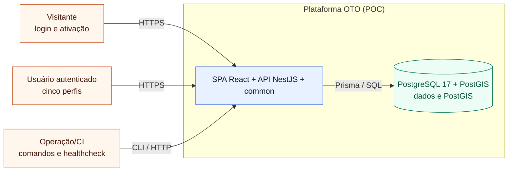
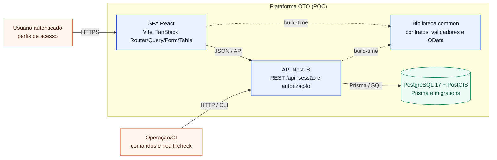

# Contexto e contêineres

## Contexto

As visões usam Mermaid flowchart para evitar a sobreposição de ícones e rótulos do C4; os níveis C4 orientam a organização. A plataforma OTO é uma POC local. Os atores humanos usam a interface web; operação e CI
executam comandos administrativos e verificam a saúde. Não há integração externa
implementada nesta etapa: Looker Studio, e-mail/notificações e BI continuam planejados ou
condicionados.

## Contêineres

O frontend é servido pelo Vite em desenvolvimento; o build estático existe, mas não há
serviço de frontend no Compose. A API e o PostgreSQL/PostGIS formam os contêineres do
Compose local. O pacote `common` é uma biblioteca de build-time, não um serviço em
execução.

## Decisões visíveis nos contêineres

- **Sessão no servidor:** a SPA não guarda token em `localStorage`; a API usa cookie
  `HttpOnly`, `SameSite=Lax` e `Secure` em produção.
- **Autorização central:** a API revalida sessão e permissão em cada requisição; a interface
  apenas evita exibir telas sem permissão.
- **Contexto de entidade:** o cabeçalho `x-identification` é um filtro de escopo, não uma
  prova de acesso.
- **Contratos compartilhados:** a SPA e a API importam `@ssc0536/common`; não há cópia de
  contratos entre os apps.
- **Persistência especializada:** PostGIS e constraints de exclusão de vigência não são
  representados pelo acesso tipado do Prisma Client; usam SQL/migrations controladas.
