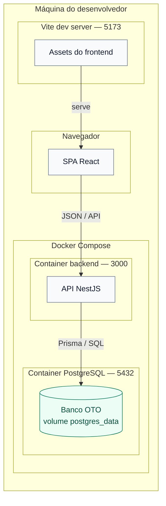
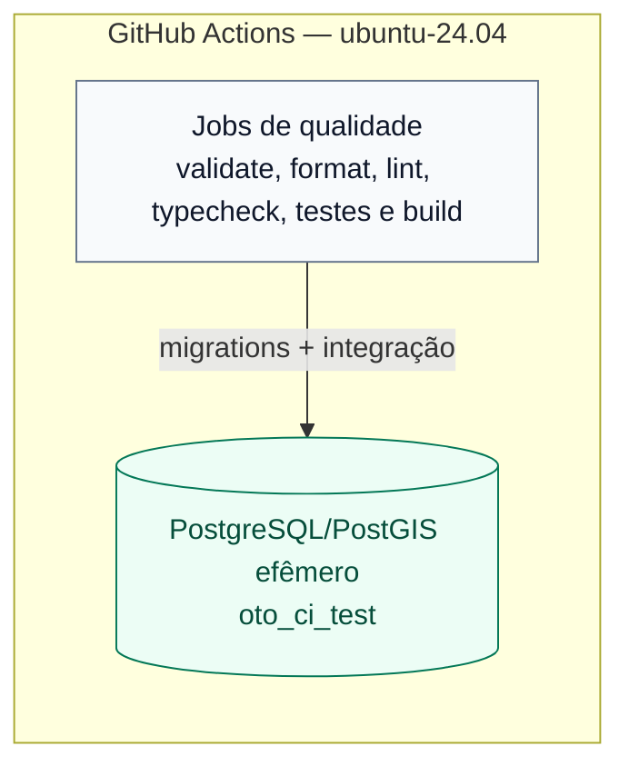

# Implantação

## Desenvolvimento local

As visões usam Mermaid flowchart para manter a leitura. O fluxo documentado no README usa Vite no host e Docker Compose apenas para API e
PostgreSQL. O frontend **não** é um serviço do Compose atual.

### Fatos operacionais

- O backend executa `pnpm db:deploy && node dist/main.js` no container; migrations são
  aplicadas na inicialização.
- O PostgreSQL usa imagem construída por `scripts/postgres.Dockerfile`, com PostGIS, e
  volume `postgres_data`.
- As portas publicadas ficam restritas a `127.0.0.1`.
- O healthcheck da API consulta `/api/health`; o do banco usa `pg_isready`.
- Variáveis relevantes: `DATABASE_URL`, `PORT`, `FRONTEND_URL`, `AUTH_COOKIE_SECURE`.
- O build do frontend gera `apps/frontend/dist`, mas não há hospedagem de produção
  definida nesta POC.

## Integração contínua

O CI não usa segredos de produção. A suíte de integração exige um banco exclusivo com
nome terminado em `_test`; migrations reais e PostGIS são necessários. A implantação de
produção, backup e recuperação pertencem ao plano 21 e não estão implementados.
