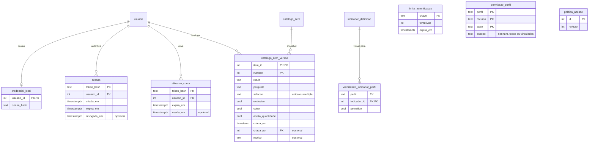

# Modelo de dados implementado

Fonte: [`apps/backend/prisma/schema.prisma`](../../apps/backend/prisma/schema.prisma) e
migrations versionadas em `apps/backend/prisma/migrations/`.

O schema atual possui **34 tabelas**. O MER recebido em 09/11/2026 tinha 26; as oito
tabelas adicionais vieram das partes 02–06 e estão destacadas abaixo. O diagrama completo
está em [`docs/mer.mmd`](../mer.mmd), com a versão em imagem em
[`docs/mer.png`](../mer.png); o snapshot original está em
[`docs/referencias/mer-original-2026-11-09/`](../referencias/mer-original-2026-11-09/README.md).
O PNG é gerado a partir do `.mmd`; em caso de divergência, prevalecem o `.mmd` e o
`schema.prisma`.

## Evoluções sobre o MER original

| Área         | Tabela                          | Origem                                 | Papel                                                   |
| ------------ | ------------------------------- | -------------------------------------- | ------------------------------------------------------- |
| Autenticação | `credencial_local`              | `20261116000000_autenticacao`          | Hash scrypt da senha, um por usuário.                   |
| Autenticação | `sessao`                        | `20261116000000_autenticacao`          | Sessão opaca com hash do token, expiração e revogação.  |
| Autenticação | `ativacao_conta`                | `20261116000000_autenticacao`          | Código de uso único para ativação/recuperação.          |
| Autenticação | `limite_autenticacao`           | `20261116000000_autenticacao`          | Janela persistida de tentativas por IP/e-mail.          |
| Acesso       | `permissao_perfil`              | `20261117000000_permissoes`            | Matriz configurável por perfil, recurso, ação e escopo. |
| Acesso       | `visibilidade_indicador_perfil` | `20261117000000_permissoes`            | Liberação explícita de indicador por perfil.            |
| Acesso       | `politica_acesso`               | `20261117000000_permissoes`            | Revisão global para invalidar caches de permissão.      |
| Catálogo     | `catalogo_item_versao`          | `20261118000000_catalogos_versionados` | Snapshot imutável do item e das regras do grupo.        |

Além dessas tabelas, as migrations 03–06 acrescentaram colunas e relações ao MER original:
`catalogo_grupo.secao`/`ativo`, `catalogo_item.outro`/`aceita_quantidade`/`versao_atual`,
`inventario_versao.criada_em`/`motivo`/`estados`/`substituida_por_id`,
`inventario_item.item_versao` e as relações de autenticação/auditoria em `usuario`.

## Domínios

| Domínio               | Tabelas                                                                                                                                                                            |
| --------------------- | ---------------------------------------------------------------------------------------------------------------------------------------------------------------------------------- |
| Cadastro              | `segmento`, `empreendimento`, `empreendimento_segmento`, `contato`, `cadastur`                                                                                                     |
| Acesso e autenticação | `usuario`, `credencial_local`, `sessao`, `ativacao_conta`, `limite_autenticacao`, `usuario_empreendimento`, `permissao_perfil`, `visibilidade_indicador_perfil`, `politica_acesso` |
| Catálogo e inventário | `catalogo_grupo`, `catalogo_item`, `catalogo_item_versao`, `inventario_versao`, `inventario_item`                                                                                  |
| Pesquisas e respostas | `pesquisa_modelo`, `pesquisa`, `pesquisa_campo`, `pesquisa_pergunta`, `resposta`, `resposta_item`                                                                                  |
| Operação e coleta     | `auditoria`, `periodo`, `coleta_diaria`, `rhc_periodo`                                                                                                                             |
| Indicadores           | `indicador_definicao`, `indicador_resultado`, `indicador_resultado_versao`, `parametro_calculo`, `indicador_resultado_parametro`                                                   |

## Evoluções de autenticação, acesso e catálogo

## Convenções preservadas

- **Ausência não é zero:** campos de capacidade e respostas usam `null` para desconhecido;
  `inventario_versao.estados` registra `nao_se_aplica`, `desconhecido` ou `vazio`.
- **Histórico imutável:** `catalogo_item_versao` é um snapshot protegido por gatilho;
  `inventario_item.item_versao` referencia o snapshot usado. Editar o catálogo não
  reescreve a leitura histórica.
- **Vigência:** datas civis `YYYY-MM-DD`; a constraint de exclusão impede sobreposição de
  versões não substituídas. Correções preservam a versão anterior via `substituida_por_id`.
- **Autoria e auditoria:** autoria vem da sessão. `auditoria` guarda antes/depois apenas
  dos campos alterados; escritas de negócio e auditoria são atômicas.
- **Escopo por vínculo:** `usuario_empreendimento` com `ativo` sustenta o escopo
  `vinculados`; não é uma permissão de negócio isolada.
- **PostGIS:** `empreendimento.localizacao` é `geography`; leitura/escrita usam SQL
  parametrizado, não o acesso tipado do Prisma Client.
- **Decimais exatos:** indicadores, diárias e parâmetros usam `Decimal`; a API os expõe
  como string para não perder precisão.

## Divergência conhecida

O MER original de 26 tabelas permanece apenas como referência histórica. Ele não contém
autenticação, permissões, visibilidade, política de acesso, versionamento de catálogo nem
as colunas citadas. Não use o PNG original para descrever o schema atual.
